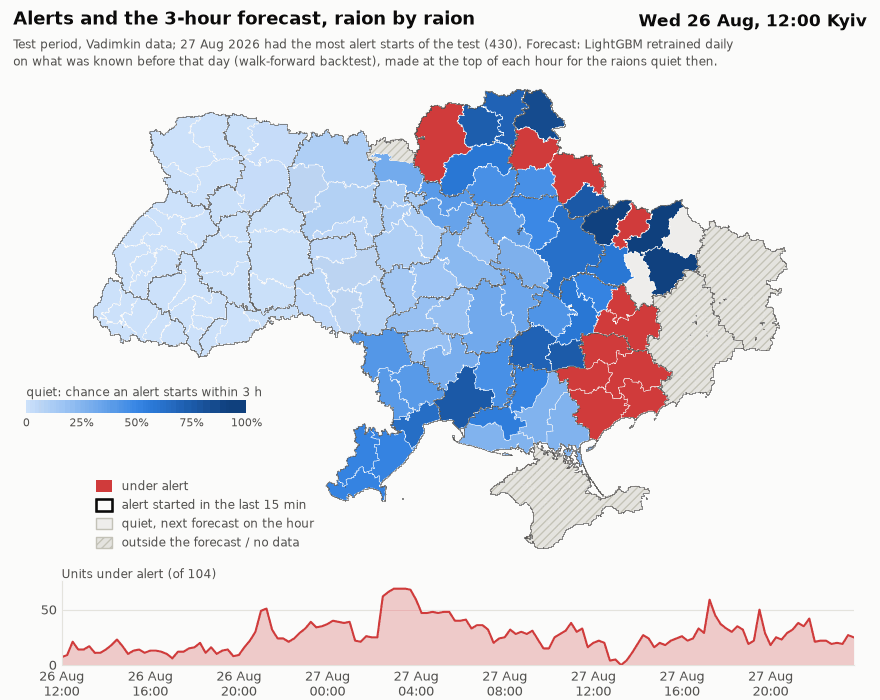
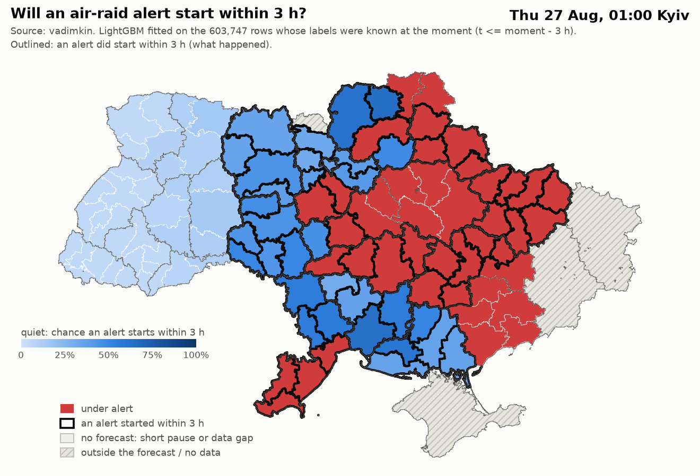
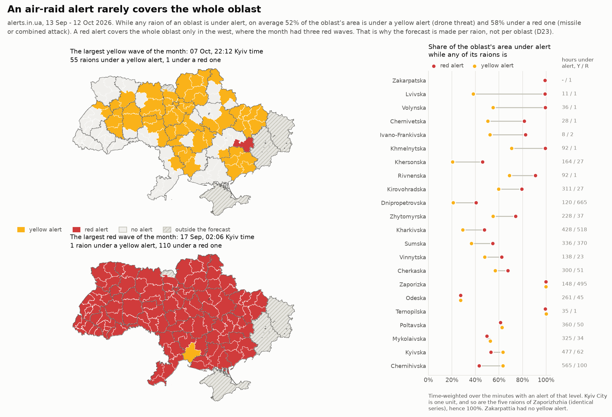
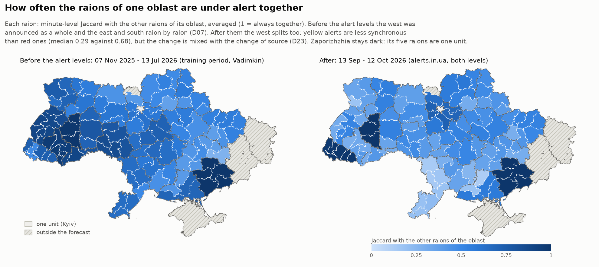

# AAFS — forecasting air-raid alerts by raion in Ukraine

Every hour, for each raion of Ukraine where it is quiet at that moment, the model gives the probability
that an air-raid alert starts there within the next 1, 3 or 6 hours. It is tested on the last four weeks
of the newest raion-level data, retrained daily, and checked for leakage from the future on every run.

## Key features

- **Result.** LightGBM beats the best baseline at every horizon: PR-AUC +0.036 / +0.027 / +0.018 at
  h = 1 / 3 / 6 on the last four weeks of data. The gain is modest, and only at h = 1 does it survive every
  robustness check of the independent reviews; [Results](#results) says where it is fragile.
- **Raion-level forecast.** The map is split into 104 forecast units: 110 raions in 22 oblasts plus Kyiv,
  with raions whose series are practically identical merged (D05, D07). An oblast is too coarse: while
  any raion of an oblast is under alert, on average only about half of its area is ([maps](#why-the-unit-is-a-raion)).
- **Data up to the last available day.** The official series of the dataset stopped on 7 September 2026,
  when the Telegram channel behind it went silent, although the dataset's README says it is updated
  daily (D02). The test is the last four weeks before that, and the frozen model was checked again one
  month later on the alerts.in.ua API, downloaded on 12 October 2026 (D22).
- **Checked after the alert-level reform.** The check one month later falls into the new yellow / red
  regime (Cabinet of Ministers resolution No. 1092, September 2026). What is left there of the frozen
  model's edge comes from red alerts; on yellow ones it is level with the baseline ([Check on fresh data](#check-on-fresh-data-alertsinua-one-month-later), D23).
- **Leakage control.** Features see only what an observer had seen by moment `t`, including records that
  the source wrote retroactively; two automated leakage checks run on the real data in every pipeline
  run (D16, D18, D21).
- **Embedding interface.** One call returns the forecast for every unit at a given hour, as a table or as
  JSON for a bot or a web service ([Embedding](#embedding)).
- **Documented decisions.** [`DECISIONS.md`](DECISIONS.md) records decisions D00–D23 (finding → decision
  → why → alternatives → status, with the numbers behind each) and the 32 AI errors caught on the way.



36 hours around the busiest day of the test (27 August 2026, 430 alert starts). Red raions are under
alert; the blue shade of a quiet raion is the forecast chance that an alert starts there within 3 hours.
The forecast is made at the top of every hour by a model that saw only what was known before that day
(walk-forward backtest); a black outline marks an alert that has just started. The animation is drawn
from the saved backtest predictions: `python scripts/make_visuals.py`.

**Try a moment yourself.** `python scripts/forecast.py --at "2026-08-27 01:00"` refits the model on what
was known at that moment (Kyiv time, any hour from 28 November 2025 to 7 September 2026), prints the
quiet raions from the most to the least likely, and shows what really happened in the next 3 hours.
`--h 1`, `--top 20`, `--map file.png`, `--csv file.csv` and `--json` are optional; `--source api` replays
the alerts.in.ua month with the frozen model (needs your own download). One moment proves nothing: on
this one all 15 most likely raions got an alert, but the model expected 16 starts and there were 30. The
honest measure is the backtest below.



## Results

**LightGBM beats the best baseline at every horizon:** PR-AUC +0.036 at h = 1, +0.027 at h = 3 and
+0.018 at h = 6 over B1, the rate of alerts per "unit × hour of day" over the last four weeks, with the
95% intervals of the day bootstrap above zero. The gain is modest, and only at h = 1 does it survive
every robustness check of the reviews (below).

Test: 2026-08-10 – 2026-09-07, retrained daily; square brackets give the 95% interval of a bootstrap
over days, differences are paired (the full table of all models is in [`reports/results.md`](reports/results.md)):

| h | Rate | B1 (unit × hour), PR-AUC | LightGBM, PR-AUC | LightGBM − B1, PR-AUC | LightGBM − B1, log loss |
|---|---|---|---|---|---|
| 1 | 0.121 | 0.398 | 0.434 | **+0.036** [+0.019, +0.050] | −0.022 [−0.033, −0.014] |
| 3 | 0.255 | 0.674 | 0.701 | **+0.027** [+0.010, +0.041] | −0.021 [−0.033, −0.009] |
| 6 | 0.360 | 0.814 | 0.832 | **+0.018** [+0.005, +0.030] | −0.019 [−0.033, −0.006] |

**Where the gain is fragile** (found in the review, [`reviews/FINAL.md`](reviews/FINAL.md), F23–F25):
- at h = 3 most of the gain comes from the days around the channel outage; on the ordinary days of the
  test (10–26 August) it is +0.010 [−0.002, +0.020];
- at h = 6 the interval reaches zero with 7-day bootstrap blocks ([−0.003, +0.024]);
- on validation, a B1 that weights recent days exponentially (half-life 7 days, fixed by the review in
  advance) is level with LightGBM at h = 3 and 6. It was not run on the test: choosing a baseline after
  seeing the test would break rule 6. So part of the edge may be memory of recent alerts rather than
  structure;
- logistic regression beats B1 significantly only at h = 1.

Where the model clearly helps is Kyiv and Kyiv oblast: at h = 3 the PR-AUC of LightGBM is 0.59 and 0.51
there, against 0.34 for B1 in both (`reports/backtest_h3.md`). Within one unit its ROC-AUC
over time is about 0.60: it tells calm hours from dangerous ones only moderately. B0 (the overall rate)
and B2 (the number of oblasts under alert) are barely better than a random forecast: in summer at least
a few frontline oblasts are always under alert, and that number stops measuring a "wave" (D18). The
calibration of LightGBM is close to the diagonal at every horizon, of LR only at h = 1
(`reports/figures/calibration_h*.png`). Forecast against fact for three units over the first test week:
[`forecast_vs_fact.png`](reports/figures/forecast_vs_fact.png).

## Why the unit is a raion

An alert rarely covers a whole oblast. While any raion of an oblast is under alert, on average about half
of the oblast's area is: 52% for a yellow (drone) alert and 58% for a red (missile) one, in the month of
alerts.in.ua data (D23). A red alert covers the whole oblast only in the west, where the month had three
nationwide red waves; in the north and the east red alerts are local too. A forecast per oblast would
call the whole oblast for an alert that half of it never gets.



How synchronous the raions of an oblast are depends on the region and has changed with the alert levels.
Before them, the west was announced almost as a whole (Ternopil 0.99, Ivano-Frankivsk 0.94, Lviv 0.88:
the median Jaccard of raion pairs over the training period), while the east and the south went raion by
raion (Dnipropetrovsk 0.39, Kherson 0.42, Chernihiv 0.47; D07). After the levels the west splits too:
yellow alerts are less synchronous across raions than red ones (median Jaccard 0.29 against 0.68), though
the comparison mixes the new regime with the new source (D23). Zakarpattia is the exception before the
levels (0.36): it has very few alerts.



## Check on fresh data: alerts.in.ua, one month later

The main test ends on 7 September. The alerts.in.ua API gives the history of the last 30 days; the
download of 12 October covers 12 September – 12 October. This is a **different source**, so the data
are not glued together: the models trained on the data up to 7 September are frozen and only predict,
while the features are computed from the API data (D22, [`reports/api_check.md`](reports/api_check.md)).

- **Matching:** all 119 locations are found, one to one. Traps caught by the checks: a different
  apostrophe character in the names; Kyiv has the type "oblast" in the API; three raions were renamed.
- **The sources agree, but they are not the same.** The time zone is right (a shift of 0 h against the
  volunteer series), and the order of raions by alert frequency is kept (Spearman 0.81). But the API
  records more alerts. The volunteer series covers both periods and separates the effects: in reality
  the starts grew ×1.26, while the pair "Vadimkin → API" gives ×1.60.
- **The frozen model:**

| h | LightGBM − B1, frozen a month ago | LightGBM − B1, refitted on the API data |
|---|---|---|
| 1 | +0.104 [+0.087, +0.119] | **+0.051** [+0.029, +0.066] |
| 3 | +0.096 [+0.081, +0.106] | +0.017 [−0.002, +0.031] |
| 6 | +0.068 [+0.059, +0.075] | +0.004 [−0.010, +0.015] |

Against the frozen baseline the gain is large, but mostly because the baseline itself went stale.
Against B1 refitted daily on the API data, the model frozen a month earlier keeps a clear advantage at
h = 1, of the same order as on the main test. At h = 3 the difference is +0.017 and its interval touches
zero (the log loss is still significantly better); on the download made one day earlier it was +0.021
[+0.002, +0.036], so at h = 3 the advantage sits at the edge of significance. At h = 6 there is none.
The leakage checks on the API period pass.

**The API window falls into the two-level regime (D23, [`reports/levels_check.md`](reports/levels_check.md)).**
In 21 of the 24 regions with alerts in the window (Kyiv included) the first yellow record falls within
the first day of the window (12 September). Dnipropetrovsk oblast switches at raion level around
21 September, and Zakarpattia has no yellow alert at all. So the check one month later also covers a
different alerting regime, and the effects of the regime and of the source cannot be separated. Three
quarters of the positive rows start with a yellow alert. Against B1 refitted on the API data, what is
left of the frozen model's advantage comes from red alerts (ROC-AUC +0.019 [+0.004, +0.032]); on yellow
ones the two are on par (+0.002 [−0.010, +0.013]). Raions of one oblast are now announced together less
often (median Jaccard 0.53 before, 0.42 after, mixed with the change of source).

To reproduce: get your own token at alerts.in.ua, put it into `alerts_api/token.txt` (the file is in
`.gitignore`) or into the variable `ALERTS_IN_UA_TOKEN`, then run `python scripts/fetch_alerts_in_ua.py --all-oblasts`
into an empty `data/raw/alerts_in_ua/` (about 14 minutes because of the limit of 2 requests per minute)
and `python scripts/api_check.py` (then `python scripts/levels_check.py` for the alert levels). The raw
API responses are not in the repository: the terms of their publication are not defined.

## What keeps the numbers honest

- **One command rebuilds everything from scratch:** `python scripts/run_all.py` downloads the pinned
  dataset snapshot (commit `58ee75b`; the SHA-256 of the file is checked on every load), builds the
  tables, features, backtests and reports, and exits with code 1 if any number differs from the
  reference table in `DECISIONS.md` or if a leakage check fails.
- **Two leakage checks run on the real data in every run** (`reports/leakage_check.json`):
  - *corrupting the future* (D18): all records after the cut are shuffled and everything is rebuilt; the
    training rows, the features and the forecasts of all models at the cut must match bit for bit;
  - *knowledge at the cut* (D21): what the dataset held at the cut is reconstructed, including records
    written later than their timestamps; the features must match those computed on the full data.

  Both also run in the tests on synthetic data; that each fails on a leaking variant was checked by
  swapping one in by hand. Limits found by the reviews (`reviews/FINAL.md`, F08, F33–F35): the cuts on
  the real data contain no retroactive end, so that class of leak (D16) is covered by the synthetic test
  only; *corrupting the future* rebuilds the rows with its own copy of the walk-forward rule, so the row
  selection of the backtest itself was checked by reading the code; and the knowledge check models six
  real one-hour alerts differently from the observer table, so at seven hourly cuts outside the
  configured ones it fails without a leak.
- **Features cannot reach the raw tables:** they read the history only through `AlertHistory` (D21), so a
  new feature is checked automatically.
- **Decisions about the data are fixed before the metrics:** thresholds, merged raions and masks come
  from the training period; hyperparameters are chosen once on validation; nothing is tuned on the test
  (`PLAN.md`, rules 5–6). All constants live in `config.yaml`.
- **37 tests** (`python -m pytest`), including the leakage checks.

## How it was built

The project was built with AI assistants (Claude Code, Gemini in Antigravity) following the plan and the
working rules in [`PLAN.md`](PLAN.md). Every non-trivial decision is recorded in
[`DECISIONS.md`](DECISIONS.md) (in Russian), together with the reference numbers that `run_all.py` checks
and a log of 32 AI errors caught on the way, each with how it was found. Three of them would have changed
the results:
- a 4.3-day silence of the channel inside the test went unnoticed by every agent of stage 1; without a
  mask, 7,457 test rows (13.4%) would have been false "no alert" labels (D15);
- the history read alert ends that the source writes retroactively: a leak that the first leakage check
  could not see and that a question from the author exposed (D16, D21);
- the gain of the frozen model one month later would have been reported as +0.096 PR-AUC instead of
  +0.017, because the baseline had gone stale (D22).

After the stages were built, the project went through two independent review sets, Claude agents and
Gemini agents, with the same prompts: seven reviews each, covering stages 0–8
([`reviews/prompts/`](reviews/prompts/)). A final synthesis ([`reviews/FINAL.md`](reviews/FINAL.md), in
Russian) merged them into one plan and settled every disagreement on the data. Both sets found the same
main problems, but the weaker one was confidently wrong in numbers (an estimate of lost alerts ten times
too high) and marked all its findings "confirmed": a majority vote would have given wrong conclusions.
The fragile spots of the result above and the limits of the leakage checks come from this review.

All reports are in [`reports/`](reports/).

## Data

**Why the data end on 7 September 2026 (D01, D02).** The source is the official series of
[Vadimkin/ukrainian-air-raid-sirens-dataset](https://github.com/Vadimkin/ukrainian-air-raid-sirens-dataset),
which is collected from the Telegram channel `air_alert_ua`. Daily commits to the dataset continue, but
the file `official_data_en.csv` has not changed since commit `58ee75b` (8 September): after that date
only the volunteer oblast-level data are updated.
- How this was checked: the commit history (the file is byte-identical up to 10 October); the last
  processed post (ID 338380) is the last post of the channel itself; a manual check of the channel.
- Considered and rejected: the volunteer series (oblasts only, not raions); our own parsing of the same
  channel (there are no new posts); the alerts.in.ua API, a source with different processing that cannot
  be glued to the test. It is used separately, as a check one month later (section above).
- The snapshot is pinned: commit `58ee75b`; the SHA-256 of the file is checked on every load.
- The channel went silent a day after the two-level alert system started in Kyiv. Whether the two are
  connected is a hypothesis; it has not been checked (D23).

**Preparation (D03–D15):**
- 38% of the rows of the file are exact duplicates; deduplication is the first step;
- the raion-level mode applies in all oblasts since 2025-11-07: this is the start of the working period;
- 110 raions in 22 oblasts plus Kyiv. Raions with practically identical series (list posts of the
  channel) are merged: 104 units. Donetsk oblast is only an input for features;
- alerts longer than a day and alerts with an end invented by the dataset's processor are masked as
  "status unknown" rather than truncated;
- from 29 August to 2 September the channel was silent for 4.3 days; the gap is masked (D15).

**Changes in the alert system:**
- 7 November 2025: alerts are announced by raion in every oblast (D04). The working period starts here.
- September 2026: two alert levels (Cabinet of Ministers resolution No. 1092 of 4 September 2026). Yellow
  means a drone threat (a 30 s siren; businesses with a shelter may keep working), red means a missile or
  combined attack (a 60 s siren; work stops). Kyiv tested the system from 06:00 Kyiv time on 6 September,
  and the other oblasts switched gradually (D23). The main test ends on 7 September: only 19 of its
  46,270 rows (Kyiv, 6 September) fall after Kyiv's switch, all of them with y = 0. Without them the results
  stay the same to the third decimal.

**Split (D14):** training until 2026-07-13, validation 4 weeks, test 2026-08-10 – 2026-09-07.

## How it works

- **Target (D17):** for a unit that is quiet at moment `t`, whether an alert starts in `(t, t+h]`.
- **Backtest (D18):** for each test day the model is retrained on the rows whose labels are already known
  by that day (`t ≤ day − h`). Metrics: PR-AUC, ROC-AUC, Brier, log loss; intervals: a bootstrap over
  whole days, with paired differences between models.
- **Baselines:** B0, the overall rate; B1, the rate per "unit × hour of day" over 4 weeks; B2, the rate
  by the number of oblasts under alert.
- **Features (D19):** the history of the unit itself, its oblast, the country and the neighbours.
  Adjacency is built from the raion boundaries of the dataset snapshot, not from memory. Calendar, unit
  identity.
- **Models (D20):** logistic regression and LightGBM. Hyperparameters, including the weight of recent
  data, are chosen once on validation.
- **History as of `t` (D16, D21):** an alert end invented by the dataset's processor is written
  retroactively, so the alert counts as open until the next start, as a real-time observer saw it.

## Embedding

The forecast is a function of a moment: `alerts.forecast.Forecaster` takes the model data once and then
answers for any hour. From the command line, `--json` prints the forecast of every unit to stdout, with
logs on stderr, so a bot or a service can call the script and parse the output:

```
python scripts/forecast.py --at "2026-08-27 01:00" --json
```
```
{"moment_utc": "2026-08-26T22:00:00+00:00", "moment_kyiv": "2026-08-27T01:00:00+03:00", "horizon_h": 3,
 "question": "will an air-raid alert start in the unit within 3 h", "source": "vadimkin",
 "model": "LightGBM fitted on the 603,747 rows whose labels were known at the moment (t <= moment - 3 h)",
 "outcome_known": true,
 "units": [{"unit_id": "U041", "unit": "Koriukivskyi raion", "oblast": "Chernihivska", "status": "quiet",
            "p": 0.6447, "p_b1": 0.6741, "alert_started_utc": "2026-08-26T23:02:13+00:00"}, ...]}
```

`status` is `quiet` (with a probability), `under_alert` or `no_forecast` (a short pause between alerts or
a data gap). From Python, with `src` on the import path (`PYTHONPATH=src`; the scripts add it themselves):

```python
from alerts.config import load_config
from alerts.forecast import Forecaster
from alerts.pipeline import build_all, model_data

cfg = load_config()
fc = Forecaster(cfg, model_data(build_all(cfg), cfg))   # about half a minute; the script caches this frame
res = fc.at("2026-08-27 01:00", h=3)                    # Kyiv time; utc=True for UTC
res.quiet[["unit", "oblast", "p"]].head()               # or res.to_json()
```

Today this replays past hours: the data end on 7 September (Vadimkin) and on the day of the API
download. To forecast the current hour, three steps are missing; the plan is in `PLAN.md`, "Вне MVP":
- a scheduled job that refreshes the alerts.in.ua history (27 requests at 2 per minute, about 14
  minutes, so once a day) and between refreshes polls the active alerts to keep its own log;
- the moment set to the current hour, with alerts open at the download counted as ongoing;
- a model refitted or recalibrated on the API data: the model frozen on 7 September keeps a clear edge
  on the new source only at h = 1, and its absolute probabilities are unreliable there (D22).

## Limitations

- The model has not seen data for a month: the main series ended on 7 September. In a real deployment it
  would have to be retrained.
- Part of the edge over B1 may be memory of recent alerts: a B1 with exponential weights is level with
  LightGBM on validation at h = 3 and 6 and was not run on the test ([Results](#results)).
- `scripts/forecast.py` replays past hours; it is not a live forecast. What a live one needs is listed in
  [Embedding](#embedding).
- The models were trained before the alert levels were introduced. The level is used neither as a feature
  nor as a target, because there is no labelled history before September; the target counts an alert of
  any level (D23).
- In the API data Lviv oblast has yellow alerts from 12 September, while a local news source dates the
  oblast's switch to 12 October. This discrepancy is not resolved (D23).
- Raion-level threat posts were checked on a sample of 60 posts, not on the full archive of the channel
  (D09).
- If an all-clear was lost and a new alert came within three hours, the dataset's processor silently
  replaces the first alert: such cases can be neither found nor fixed (D09).
- The masks (D10, D15) remove 15.9% of the unit-hours from the test, almost all of it the channel outage.
- Right edge: alerts not closed before the channel stopped are missing from the data (D13).
- The test has no alert at all in Lviv, Ivano-Frankivsk and Zakarpattia oblasts: the metrics for them are
  undefined.

## Running

```
pip install -r requirements.txt
python scripts/run_all.py        # data snapshot -> tables -> features -> backtest -> reports (~30 min)
python -m pytest                 # tests
python scripts/make_visuals.py   # maps and the animation in reports/figures (~1.5 min)
python scripts/forecast.py --at "2026-08-27 01:00"   # the forecast at one moment, and what happened
```

`run_all.py` downloads the pinned dataset snapshot itself, checks all reference numbers against
`DECISIONS.md` and exits with code 1 on any mismatch or failed leakage check. The check on fresh data
needs your own alerts.in.ua token (see [Check on fresh data](#check-on-fresh-data-alertsinua-one-month-later)).
Old files of the early stages are in `archive/`.
