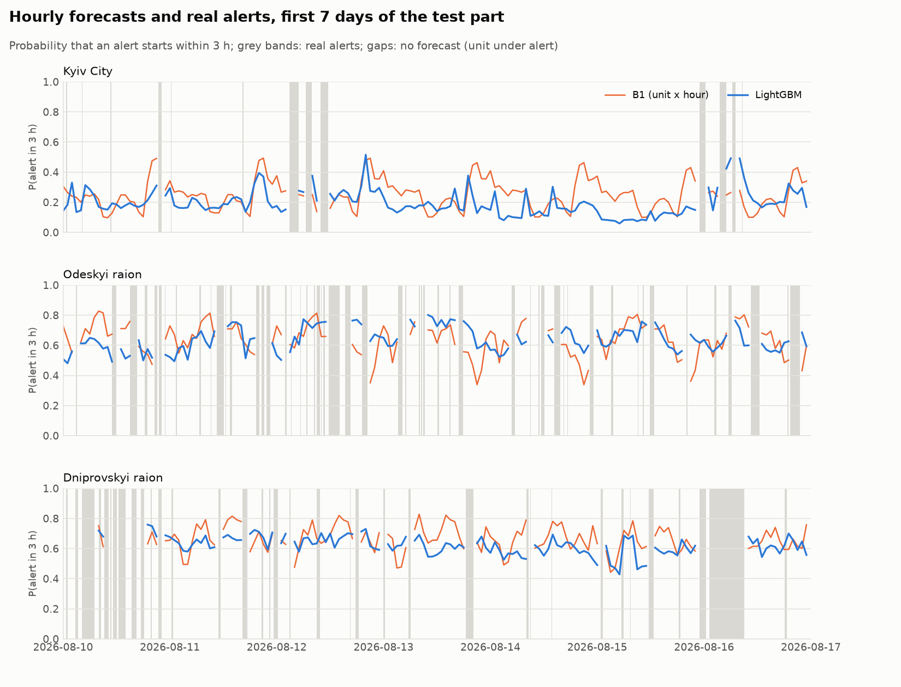

# AAFS — forecasting air-raid alerts by raion in Ukraine

Every hour, for each raion where it is quiet right now, the model estimates the probability that an
air-raid alert starts there within the next `h` hours (1, 3 or 6; the main horizon is 3). It is
evaluated on the last four weeks of the available data, retrained daily, with checks for leakage from
the future.

Decisions in detail are in [`DECISIONS.md`](DECISIONS.md) (D00–D22, plus the log of AI errors that were
caught), the plan and the status of the stages are in [`PLAN.md`](PLAN.md) (both in Russian), and all
the numbers are in [`reports/`](reports/).

## Results

Test: 2026-08-10 – 2026-09-07, retrained daily; square brackets give the 95% interval of a bootstrap
over days, differences are paired (the full table of all models is in [`reports/results.md`](reports/results.md)):

| h | Rate | B1 (unit × hour), PR-AUC | LightGBM, PR-AUC | LightGBM − B1, PR-AUC | LightGBM − B1, log loss |
|---|---|---|---|---|---|
| 1 | 0.121 | 0.398 | 0.434 | **+0.036** [+0.019, +0.050] | −0.022 [−0.033, −0.014] |
| 3 | 0.255 | 0.674 | 0.701 | **+0.027** [+0.010, +0.041] | −0.021 [−0.033, −0.009] |
| 6 | 0.360 | 0.814 | 0.832 | **+0.018** [+0.005, +0.030] | −0.019 [−0.033, −0.006] |

Logistic regression lies between B1 and LightGBM. B0 (the overall rate) and B2 (the number of oblasts
under alert) are barely better than a random forecast: in summer at least a few frontline oblasts are
always under alert, and that number stops measuring a "wave" (D18). The calibration of LR and LightGBM
is close to the diagonal (`reports/figures/calibration_h*.png`).

The models beat the best baseline, and the difference is statistically significant but modest. Most of
the gain is within oblasts: B1 rests almost entirely on the "east versus west" difference, while the
model tells moments and neighbouring raions apart. For example, on the test at h = 3 the PR-AUC in Kyiv
is 0.63 for LR versus 0.34 for B1, and in Kyiv oblast 0.55 versus 0.34 (`reports/backtest_h3.md`).



## Data

**Why the data end on 7 September 2026 (D01, D02).** The source is the official series of
[Vadimkin/ukrainian-air-raid-sirens-dataset](https://github.com/Vadimkin/ukrainian-air-raid-sirens-dataset),
which is collected from the Telegram channel `air_alert_ua`. Daily commits to the dataset continue, but
the file `official_data_en.csv` has not changed since commit `58ee75b` (8 September): after that date
only the volunteer oblast-level data are updated.
- How this was checked: the commit history (the file is byte-identical up to 10 October); the last
  processed post (ID 338380) is the last post of the channel itself; a manual check of the channel.
- Considered and rejected: the volunteer series (oblasts only, not raions); our own parsing of the same
  channel (there are no new posts); the alerts.in.ua API, a source with different processing that cannot
  be glued to the test. It is used separately, as a check one month later (section below).
- The snapshot is pinned: commit `58ee75b`; the SHA-256 of the file is checked on every load.

**Preparation (D03–D15):**
- 38% of the rows of the file are exact duplicates; deduplication is the first step;
- the raion-level mode applies in all oblasts since 2025-11-07: this is the start of the working period;
- 110 raions in 22 oblasts plus Kyiv. Raions with practically identical series (list posts of the
  channel) are merged: 104 units. Donetsk oblast is only an input for features;
- alerts longer than a day and alerts with an end invented by the dataset's processor are masked as
  "status unknown" rather than truncated;
- **from 29 August to 2 September the channel was silent for 4.3 days** (found during the review, D15).
  This gap is masked; without the mask 13% of the test rows would be false "zeros".

**Split (D14):** training until 2026-07-13, validation 4 weeks, test 2026-08-10 – 2026-09-07.

## How it works

- **Target (D17):** for a unit that is quiet at moment `t`, whether an alert starts in `(t, t+h]`.
- **Backtest (D18):** for each test day the model is retrained on the rows whose labels are already known
  by that day (`t ≤ day − h`). Metrics: PR-AUC, ROC-AUC, Brier, log loss; intervals: a bootstrap over
  whole days, with paired differences between models.
- **Baselines:** B0, the overall rate; B1, the rate per "unit × hour of day" over 4 weeks; B2, the rate
  by the number of oblasts under alert.
- **Features (D19):** the history of the unit itself, its oblast, the country and the neighbours.
  Adjacency is built from the raion boundaries of the dataset snapshot, not from memory. Calendar, unit
  identity.
- **Models (D20):** logistic regression and LightGBM. Hyperparameters, including the weight of recent
  data, are chosen once on validation.

## Protection against leakage

- Features read the history only through `AlertHistory`. It returns what an observer saw up to moment
  `t`: an alert end invented by the processor is written retroactively, so the alert counts as open
  until the next start (D16, D21).
- **Corrupting the future** (D18): all records after the cut are shuffled and everything is rebuilt; the
  training rows, the features and the forecasts of all models at the cut match bit for bit.
- **Knowledge at the cut** (D21): what the dataset held at the cut is reconstructed, including records
  written later than their own timestamps. The features must match those computed on the full data.
- Both checks run on real data in every run (`reports/leakage_check.json`) and in the tests on synthetic
  data; each was verified by swapping in a variant with a leak.

## Check on fresh data: alerts.in.ua, one month later (D22)

The main test ends on 7 September. The alerts.in.ua API gives the history of the last 30 days; the
download of 12 October covers 12 September – 12 October. This is a **different source**, so the data
are not glued together: the models trained on the data up to 7 September are frozen and only predict,
while the features are computed from the API data. Details are in [`reports/api_check.md`](reports/api_check.md).

- **Matching:** all 119 locations are found, one to one. Traps caught by the checks: a different
  apostrophe character in the names; Kyiv has the type "oblast" in the API; three raions were renamed.
- **The sources agree, but they are not the same.** The time zone is right (a shift of 0 h against the
  volunteer series), and the order of raions by alert frequency is kept (Spearman 0.81). But the API
  records more alerts. The volunteer series covers both periods and separates the effects: in reality
  the starts grew ×1.26, while the pair "Vadimkin → API" gives ×1.60.
- **The frozen model:**

| h | LightGBM − B1, frozen a month ago | LightGBM − B1, refitted on the API data |
|---|---|---|
| 1 | +0.104 [+0.087, +0.119] | **+0.051** [+0.029, +0.066] |
| 3 | +0.096 [+0.081, +0.106] | +0.017 [−0.002, +0.031] |
| 6 | +0.068 [+0.059, +0.075] | +0.004 [−0.010, +0.015] |

Against the frozen baseline the gain is large, but mostly because the baseline itself went stale.
Against B1 refitted daily on the API data, the model frozen a month earlier keeps a clear advantage at
h = 1, of the same order as on the main test. At h = 3 the difference is +0.017 and its interval touches
zero (the log loss is still significantly better); on the download made one day earlier it was +0.021
[+0.002, +0.036], so at h = 3 the advantage sits at the edge of significance. At h = 6 there is none.
The leakage checks on the API period pass.

To reproduce: get your own token at alerts.in.ua, put it into `alerts_api/token.txt` (the file is in
`.gitignore`) or into the variable `ALERTS_IN_UA_TOKEN`, then run `python scripts/fetch_alerts_in_ua.py --all-oblasts`
into an empty `data/raw/alerts_in_ua/` (about 14 minutes because of the limit of 2 requests per minute)
and `python scripts/api_check.py`. The raw API responses are not in the repository: the terms of their
publication are not defined.

## Limitations

- The model has not seen data for a month: the main series ended on 7 September. In a real deployment it
  would have to be retrained.
- Raion-level threat posts were checked on a sample of 60 posts, not on the full archive of the channel
  (D09).
- If an all-clear was lost and a new alert came within three hours, the dataset's processor silently
  replaces the first alert: such cases can be neither found nor fixed (D09).
- The masks (D10, D15) remove 15.9% of the unit-hours from the test, almost all of it the channel outage.
- Right edge: alerts not closed before the channel stopped are missing from the data (D13).
- The test has no alert at all in Lviv, Ivano-Frankivsk and Zakarpattia oblasts: the metrics for them are
  undefined.
- In the west raions are almost always announced together, so raion-level differentiation is weak there;
  in the east and the centre it really works (D07).

## Running

```
pip install -r requirements.txt
python scripts/run_all.py        # data snapshot -> tables -> features -> backtest -> reports (~30 min)
python -m pytest                 # tests
```

`run_all.py` downloads the pinned dataset snapshot itself, checks all reference numbers against
`DECISIONS.md` and exits with code 1 on any mismatch or failed leakage check. The check on fresh data
needs your own alerts.in.ua token (see the section above).

## Process

The project was built with AI assistants (Claude Code, Gemini in Antigravity) following the plan in
`PLAN.md`. Every non-trivial decision and every caught AI error is recorded in `DECISIONS.md`: the log
holds 28 cases, from invented numbers and unchecked conclusions to a leak from the future that was found
by a human, not by a test. Old files of the early stages are in `archive/`.
